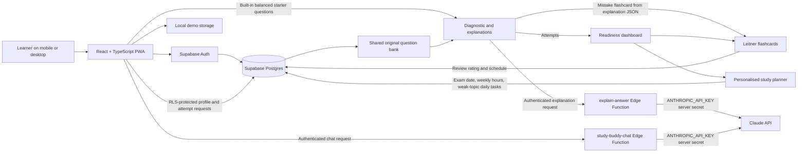

# AZ-900 Adaptive Study Buddy (Unofficial)

A mobile-first study companion for beginners preparing for the AZ-900 exam. The current implementation includes project setup, Supabase authentication, onboarding, a balanced 24-question diagnostic, cached AI explanations, an adaptive readiness dashboard, mistake-made flashcards with Leitner spaced repetition, a personalised study planner, and an English-only study chat.

> **Unofficial AZ-900 study tool. Not affiliated with or endorsed by Microsoft.**

All diagnostic questions in this project are original practice questions based on the public AZ-900 skills outline. They are not real exam questions.

## What is included

- React, TypeScript, Vite, Tailwind CSS, Lucide icons, and shadcn-style reusable button primitives.
- Supabase email/password and Google OAuth sign-in, when Supabase is configured.
- A local demo that needs no account or network connection.
- Onboarding for exam date and weekly study time.
- A one-question-at-a-time diagnostic with 24 original questions (eight from each AZ-900 domain), instant correctness feedback, and beginner-friendly base explanations.
- A Supabase `explain-answer` Edge Function that validates the learner, checks an explanation cache keyed by question and selected answer, calls Claude only on cache misses, validates the JSON response, and falls back to the question's trusted base explanation.
- A per-user limit of 30 uncached explanation requests per 60 seconds, plus a 10-second Claude request timeout.
- A readiness dashboard with a recency-weighted last-10-attempt accuracy per topic, editable domain weights in `src/config/readiness.ts`, a readiness ring, topic chart, confidence note under 25 attempts, and weak-topic practice links.
- Wrong answers automatically create one flashcard per question using the explanation response's flashcard fields. Demo cards stay on the device; signed-in cards are protected by RLS.
- Leitner review boxes use 1, 2, 4, 7, and 14-day intervals. “Got it” advances a box; “Missed” returns to box 1 and schedules the card for the next day.
- A study planner creates daily tasks from the learner's exam date, weekly study hours, recent weak topics, and configurable domain weights. Plans are saved in `study_plans`; tasks can be marked complete. If the exam is fewer than seven days away, it creates a compressed day-by-day plan, scales sessions to the remaining time, and schedules a mock exam before exam day when possible.
- An authenticated `study-buddy-chat` Edge Function calls Claude server-side, enforces a 10-second timeout and per-user rate limit, validates request size, and answers in English. Demo mode does not send messages to an AI provider.
- Supabase migrations with row-level security for profiles, questions, attempts, AI explanation cache, flashcards, and study plans.
- An installable PWA manifest and production service-worker support.
- Loading skeletons, accessible dismissible error toasts, correct-answer confetti, and light/dark system theme styling across the study screens.

## Run locally

1. Install Node.js 20.19+ or 22.12+ and npm.
2. Install dependencies:

   ```sh
   npm install
   ```

3. For the account-backed experience, create a Supabase project, install the Supabase CLI, link the project with `supabase link --project-ref <project-ref>`, and copy `.env.example` to `.env.local`. Set:

   ```dotenv
   VITE_SUPABASE_URL=https://your-project.supabase.co
   VITE_SUPABASE_ANON_KEY=your-public-anon-key
   ```

   The anon key is intended for the browser and is protected by the migration's RLS policies. Never put a Supabase service-role key or an AI provider key in a `VITE_` variable or client file.

4. In Supabase Authentication settings, enable Email. To enable Google, configure the Google provider and its redirect URLs for your local and deployed app origins.
5. Set the Claude API key as a Supabase Function secret, apply the migrations, and deploy the Edge Function:

   ```powershell
   $secureKey = Read-Host "Anthropic API key" -AsSecureString
   $keyPointer = [Runtime.InteropServices.Marshal]::SecureStringToBSTR($secureKey)
   try {
     $env:ANTHROPIC_API_KEY = [Runtime.InteropServices.Marshal]::PtrToStringBSTR($keyPointer)
     supabase secrets set "ANTHROPIC_API_KEY=$env:ANTHROPIC_API_KEY"
   } finally {
     [Runtime.InteropServices.Marshal]::ZeroFreeBSTR($keyPointer)
     Remove-Item Env:ANTHROPIC_API_KEY -ErrorAction SilentlyContinue
   }
   supabase db push
   supabase functions deploy explain-answer
   supabase functions deploy study-buddy-chat
   ```

   Create the API key in your Anthropic Console. The key is stored only in Supabase's secret store; do not put it in `.env.local`, a `VITE_` variable, or client-side code. The function also uses the Supabase-provided `SUPABASE_URL`, `SUPABASE_ANON_KEY`, and `SUPABASE_SERVICE_ROLE_KEY` runtime secrets.

6. Start the Vite development server:

   ```sh
   npm run dev
   ```

7. Without Supabase environment variables, choose **Explore a demo**. Profile and answer progress are saved only in local storage on that device. With Supabase configured, sign in or create an account, then complete onboarding.

### Study materials and question bank

The `study-materials` folder contains an AZ-900 review guide covering cloud concepts, Azure architecture and services, and management and governance. It complements the practice questions; use Microsoft's current [AZ-900 study guide](https://learn.microsoft.com/en-us/credentials/certifications/resources/study-guides/az-900) for the official skills measured and exam updates.

The quiz includes a built-in, balanced 24-question starter set. The seed folder contains 15 database-ready original practice questions (five per domain). Import them with a server-side service-role key (never the browser anon key):

```powershell
$env:SUPABASE_URL = "https://your-project.supabase.co"
$env:SUPABASE_SERVICE_ROLE_KEY = "your-service-role-key"
npm run seed
```

The app combines available database questions with distinct built-in questions to keep the diagnostic balanced at eight questions per domain. Answers to database-backed questions are saved to the signed-in user's `attempts` table; built-in questions and demo answers are saved on the device. Add at least eight verified questions per domain to use a fully database-backed diagnostic.

The third migration adds a unique `(user_id, question_id)` index so a recurring mistake updates the learner's existing flashcard instead of creating duplicates. Run `supabase db push` to apply it.

The fourth migration removes the obsolete profile preference and clears the old AI explanation cache before switching its unique key to `(question_id, selected_index)`.

## Build and preview

```sh
npm run build
npm run preview
```

The production build emits the web app manifest and service worker. Serve the preview over HTTPS (or localhost) to test installation in a supported browser.

## Architecture



## Screenshots

Screenshots will be added after deployment. For now, run `npm run dev` and view the welcome, onboarding, and quiz screens in a mobile viewport.

## Prompt Engineering

The `explain-answer` Edge Function uses a fixed system prompt and sends only the question, four options, correct answer, selected answer, and trusted `base_explanation`. It does not send a learner's email, display name, profile, or other personal data.

The `study-buddy-chat` Edge Function uses a separate fixed system prompt and forwards only a bounded conversation history. It requests AZ-900-only, beginner-friendly English responses under 150 words, one accurate everyday analogy, and a short check-for-understanding question. It politely redirects off-topic requests. Requests require an authenticated Supabase session, are rate-limited per user, and time out after ten seconds.

The prompts and validation are designed to:

- Treat the question, answer choices, and trusted base explanation as its only factual source.
- Explain technical terms at beginner level and use clear, simple English.
- Use at most one accurate everyday local analogy, without forcing an analogy when it could mislead.
- Return schema-validated JSON so feedback and mistake-based flashcards can be generated reliably.
- Cache valid results by question and selected option, so the same explanation is not generated twice.
- Fall back to the question's base explanation when Claude times out or returns an invalid response. Fallback responses are not cached.
- Call Claude only through the Supabase Edge Function, with provider credentials stored as Supabase secrets. No provider key belongs in browser code.
- For chat, keep the conversation scoped to AZ-900, stay concise, and finish with a small learning check; the client never calls Claude directly.
